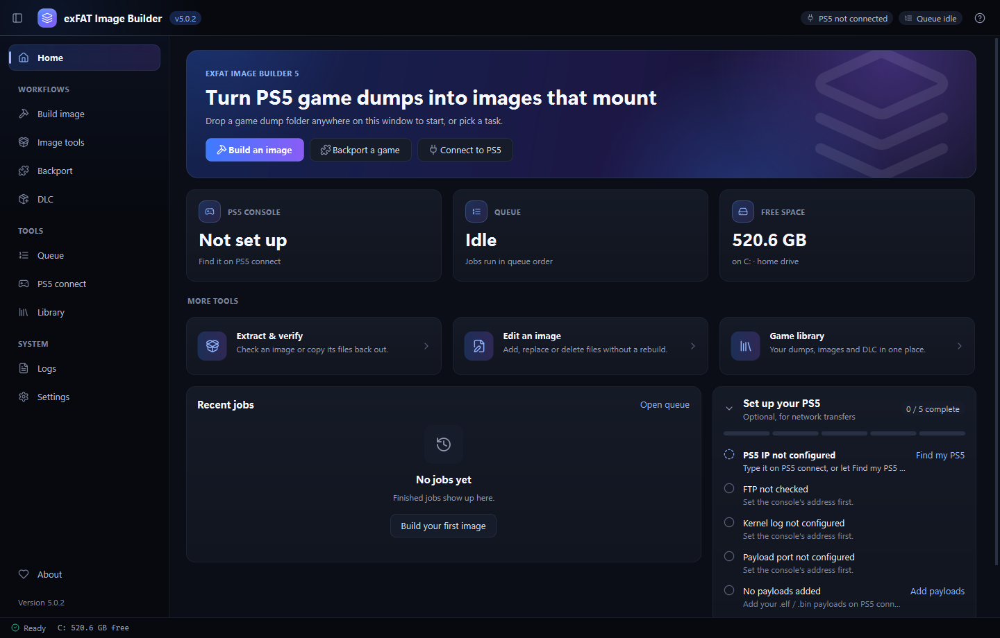
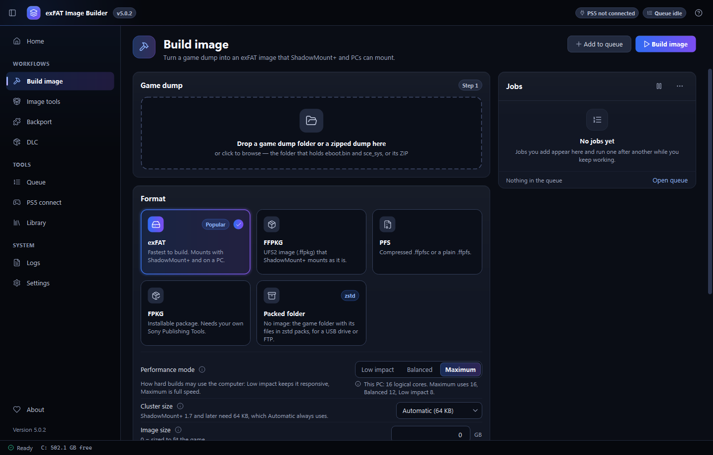
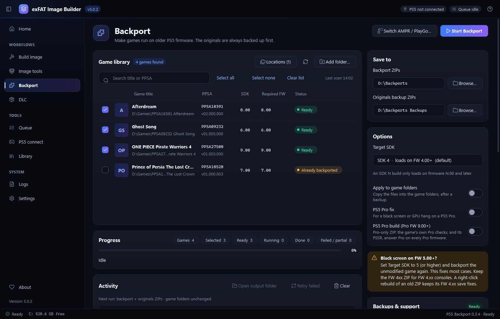
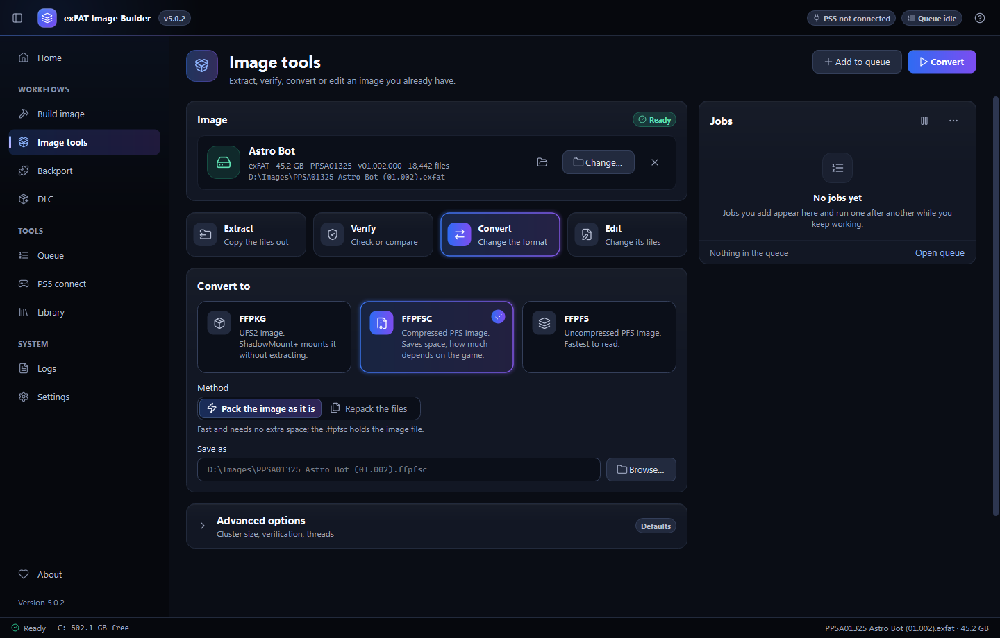
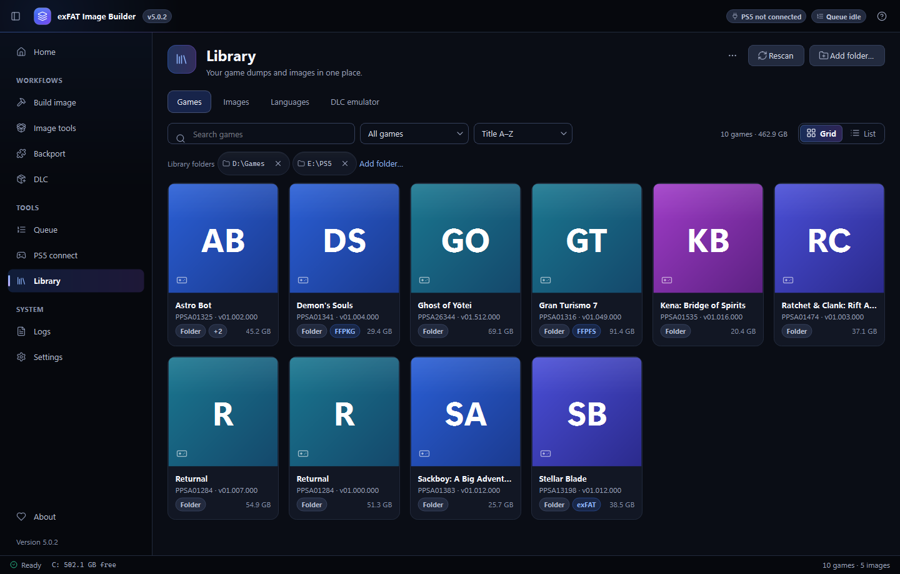
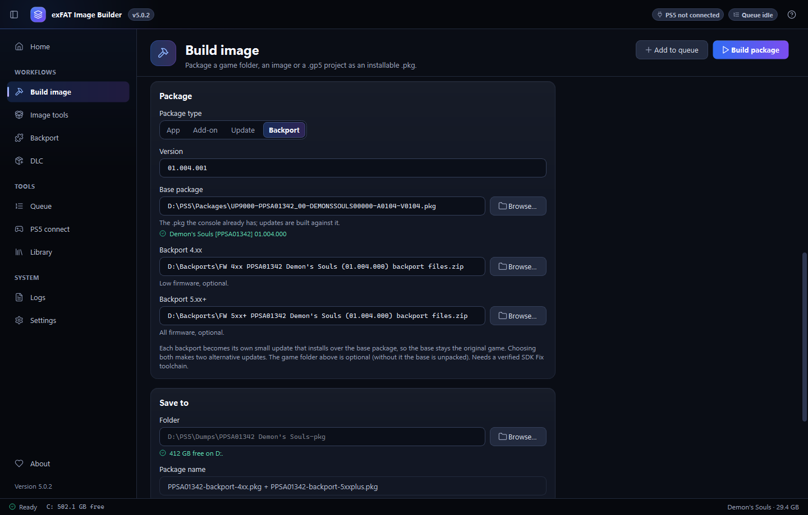
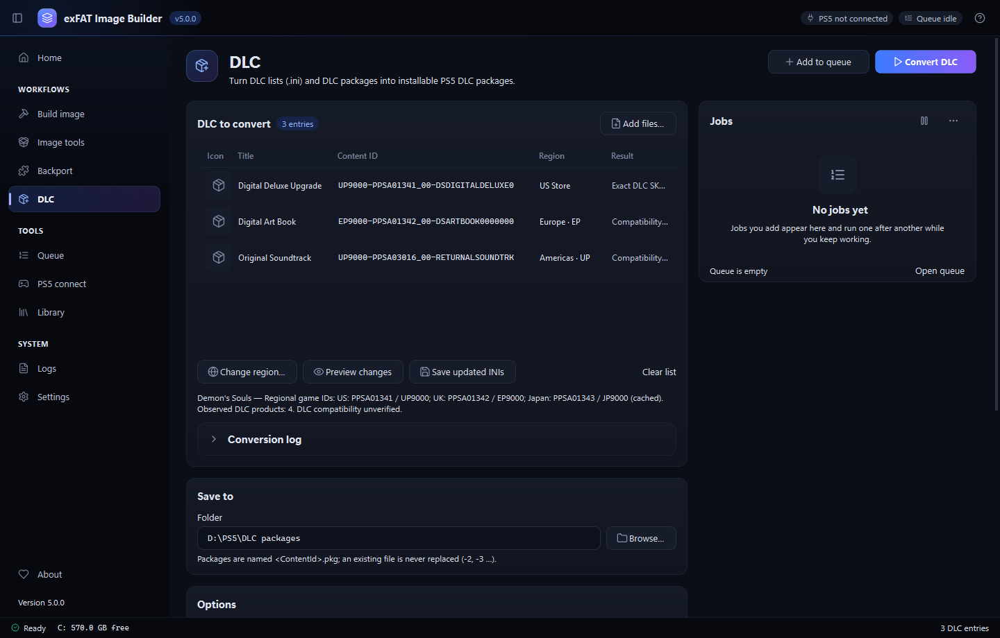
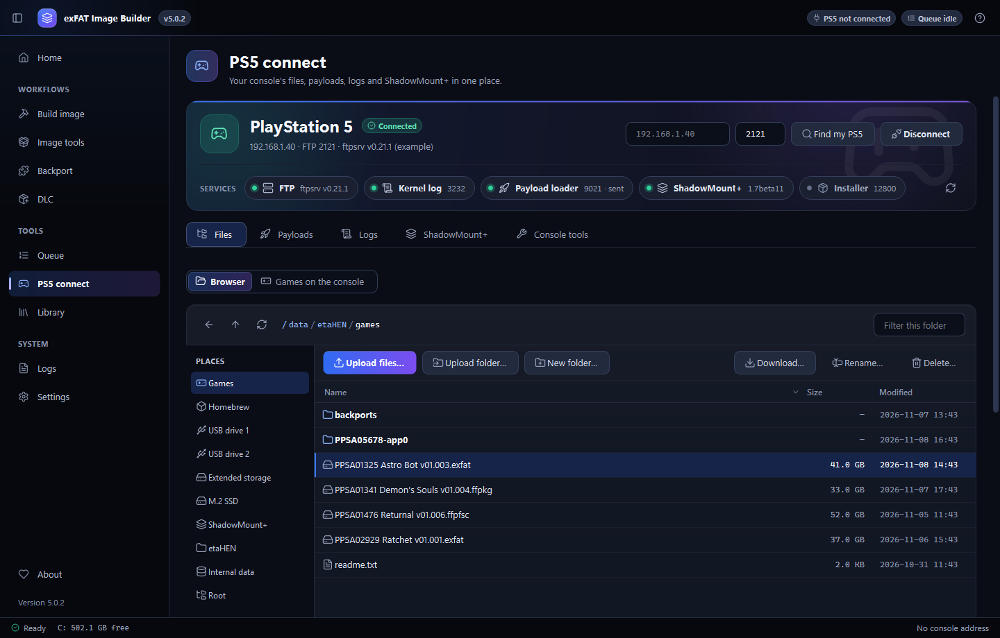

# exFAT Image Builder 5

**Turn your PS5 game dumps into images that mount — and backport, convert,
verify and send them to your console — from one app, in one download.**




> **Version 5 is a complete rewrite.** The app is now native C++/Qt: it
> writes exFAT, UFS2 and PFS images itself, so it needs **no administrator
> rights, no OSFMount, no .NET and no Python**, and it ships as **one .exe**.
>
> ⬇️ **Download 5.0.3** from the
> [Releases page](https://github.com/kerrdec97/ps5-exfat-builder/releases):
> one exe, nothing to install.

> ⚠️ For games and content **you legally own and dumped yourself**. The app
> does not download games, decrypt retail packages or bypass DRM, and it is
> not affiliated with Sony Interactive Entertainment.

---

## ✨ What it does

| | |
|---|---|
| **Build image** | Drop a dump folder (or a zipped dump), pick a format, done. **exFAT**, **FFPKG** (UFS2), **PFS** (compressed `.ffpfsc` or plain `.ffpfs`), installable **FPKG** `.pkg` (with your own Sony Publishing Tools; from a folder, any image or a packed game), or a **Packed folder** (no image: the game folder with its files in zstd packs, for a USB drive or FTP). Each output shows only its own options; experts get the rest under *Advanced options*. **Performance mode** (Low impact / Balanced / Maximum) on every format. Every image is read back and verified before it gets its final name, unless you turn verification off or cancel it (the job then says the image is not verified). |
| **zstd packs** | *Compress game files*: the game's files go into zstd packs inside the image, served on the console by the bundled **ampr-emu-ng 0.3.3** runtime. Packed games (zstd or LZ4) are read through their packs everywhere: extract, convert, FPKG. Or skip the image: **Packed folder** packs the game folder itself. |
| **Backport** | Make games run on older firmware with the built-in **PS5 Backport engine 0.3.4 by Deckerr97** — the same engine as the standalone PS5 Backport GUI, so results are identical. Target SDK 4–13, PS5 Pro fix, PS5 Pro build, AMPR / PlayGo switch, and optional apply to the game folder with a verified originals backup and one-click restore. |
| **Backport updates** | Ship a backport as its own small **update package** that installs over the game's base package, so the base stays the original game: Build image › FPKG › **Backport** (4.xx and/or 5.xx+ backport files, folder or ZIP). Each update is checked against the base before it gets its name. |
| **DLC** | Turn DLC lists (`dlc_emu.ini` and other DLC INIs) and DLC `.pkg` files into installable PS5 DLC packages, retarget them to another region's game, and save updated INIs (needs your own fpkg-cli). |
| **Image tools** | Open an image to **extract** it (packed games come out as plain files; an image inside an .ffpfsc is read straight through), **verify** it (or compare it with a folder), **convert** between exFAT, FFPKG, FFPFSC and FFPFS, or **edit** it (add, replace, rename, delete files). |
| **PS5 connect** | A real FTP file manager with a transfer queue, payload sender, kernel log and crash-dump capture, **ShadowMount+ 1.7** configuration (new format, safe-to-unplug), Fakelib manager, autoloader, AMPR index, Y2JB tools (firmware → YouTube version table, one-click install from your own YouTube packages) and package install. |
| **Library** | Your dumps and images in a cover-art grid: formats at a glance, bulk build, backport, rename. |
| **Queue** | Everything runs in a queue you can pause, reorder, cancel and retry while you keep working. The page you start a job from turns into its monitor: every stage with its time, a live progress bar, speed and time left, and the job's log as it is written. |

<p align="center">
  
  
  
  
  
  
  
</p>

## ⚡ Quick start

1. Download **`exFAT Image Builder.exe`** from the
   [Releases page](https://github.com/kerrdec97/ps5-exfat-builder/releases)
   and check its SHA-256 (below).
2. Run it. The first start unpacks the app once (a second or two); later
   starts are instant.
3. **Build image** → drop your game folder (the one with `eboot.bin`) →
   pick a format → **Build image**.

Portable use: put an empty `portable.txt` next to the exe and the app keeps
its settings, logs and unpacked files in that folder.

Antivirus removes the exe? Download the **folder edition**
(`exFAT-Image-Builder-<version>-win64-folder.zip`) from the same release
instead: extract it anywhere and run the exe inside. It is the same program,
already unpacked, so nothing unpacks itself on first start.

## 🔐 Verify your download

Every release from 5.0.0 has `SHA256SUMS.txt`. In PowerShell:

```powershell
Get-FileHash ".\exFAT.Image.Builder.exe" -Algorithm SHA256
```

The download arrives as `exFAT.Image.Builder.exe`: GitHub replaces the spaces
in the file name with dots. Compare the hash with the line in
`SHA256SUMS.txt`; capital and small letters make no difference.

## 🛡 Antivirus warnings

The exe is not code-signed and it is a self-extracting program (it unpacks
the app and the backport engine to your user folder on first start), which
some antivirus engines flag by heuristics (`Wacatac`, `!ml`). These are
guesses, not matches. You can check the hash or scan it on VirusTotal.

## 🧰 Requirements

* Windows 10 1809+ or Windows 11, 64-bit.
* Optional: your own **Sony Publishing Tools** (`prospero-pub-cmd.exe`) for
  FPKG packages (backport updates need a verified SDK Fix release). Nothing
  from Sony is included or downloaded.
* Optional: your own **fpkg-cli** (PSVIETHOA FPKG Builder, LibProsperoPkg by
  drakmor) for the DLC page.
* For console features: a jailbroken PS5 running an FTP server (ftpsrv or
  etaHEN), and ShadowMount+ to mount images.

## 🙏 Credits

Created and maintained by **Deckerr97** ([@kerrdec97](https://github.com/kerrdec97)).
This app stands on the work of these people and projects — thank you.

**Bundled with the app**

| What | By | Where |
|---|---|---|
| PS5 Backport engine 0.3.4 (Backport tab), bundled unchanged | Deckerr97 | [kerrdec97/PS5-Backport-GUI](https://github.com/kerrdec97/PS5-Backport-GUI) |
| ampr-emu-ng 0.3.3 runtime (zstd packs), bundled unchanged | quer3q | [quer3q/ampr-emu-ng](https://github.com/quer3q/ampr-emu-ng) |
| zstd compression library | Meta (Yann Collet and contributors) | [facebook/zstd](https://github.com/facebook/zstd) |
| LZ4 library (reading LZ4 packs) | Yann Collet | [lz4/lz4](https://github.com/lz4/lz4) |
| zlib | Jean-loup Gailly, Mark Adler | [madler/zlib](https://github.com/madler/zlib) |
| Qt 6 | The Qt Company and contributors | [qt.io](https://www.qt.io) |
| Lucide icons | Lucide contributors | [lucide-icons/lucide](https://github.com/lucide-icons/lucide) |

**In the owner's private build only**

| What | By | Where |
|---|---|---|
| DLC package builder | Lapy | — |
| fpkg-cli (PSVIETHOA FPKG Builder) | PSVIETHOA — Nguyễn Thanh Sơn, Ngô Phi Phương | [thanhsondev/PSVIETHOA-FPKG-Builder](https://github.com/thanhsondev/PSVIETHOA-FPKG-Builder) |
| LibProsperoPkg (the engine behind fpkg-cli) | drakmor | [drakmor/LibProsperoPkg](https://github.com/drakmor/LibProsperoPkg) |

**Code ported or formats followed**

| What | By | Where |
|---|---|---|
| PFS / FFPFSC engine (C++ port) | Nazky (Lazy_MkPFS), PSBrew (MkPFS) | [Nazky/Lazy_MkPFS](https://github.com/Nazky/Lazy_MkPFS), [PSBrew/MkPFS](https://github.com/PSBrew/MkPFS) |
| UFS2 / FFPKG image layout | SvenGDK | [SvenGDK/UFS2Tool](https://github.com/SvenGDK/UFS2Tool) |
| PS5 package facts | SvenGDK | [SvenGDK/LibProsperoPKG](https://github.com/SvenGDK/LibProsperoPKG) |
| zstd pack writer and rules, LZ4 pack reader, images inside .ffpfsc | quer3q | [quer3q/ps5-dump-forge](https://github.com/quer3q/ps5-dump-forge) |
| AMPR index and asset packs | drakmor; Nazky (Lazy_AMPR) | [drakmor/ampr_emu](https://github.com/drakmor/ampr_emu), [Nazky/Lazy_AMPR](https://github.com/Nazky/Lazy_AMPR) |
| DLC INIs (dlc_emu format) | drakmor | [drakmor/dlc_emu](https://github.com/drakmor/dlc_emu) |
| Fake-SELF reader (make_fself) | flat_z; john-tornblom (PS5 SDK); Nazky | [ps5-payload-dev/sdk](https://github.com/ps5-payload-dev/sdk) |
| Backport update packages, DLC converter | Deckerr97 (ppr-pkg Companion) | — |

**Console tools the app works with**

| What | By | Where |
|---|---|---|
| ShadowMount+ | drakmor | [drakmor/ShadowMountPlus](https://github.com/drakmor/ShadowMountPlus) |
| ftpsrv, elfldr, klogsrv | john-tornblom and ps5-payload-dev | [ps5-payload-dev](https://github.com/ps5-payload-dev) |
| etaHEN | the etaHEN team | [etaHEN/etaHEN](https://github.com/etaHEN/etaHEN) |
| kstuff-lite | EchoStretch | [EchoStretch/kstuff-lite](https://github.com/EchoStretch/kstuff-lite) |
| Y2JB | Gezine | [Gezine/Y2JB](https://github.com/Gezine/Y2JB) |
| Relapse (Y2JB on 13.40–13.60) | notmaj0r | [notmaj0r/Y2JB](https://github.com/notmaj0r/Y2JB) |
| ps5-y2jb-autoloader, ps5-unified-autoloader | itsPLK | [itsPLK/ps5-y2jb-autoloader](https://github.com/itsPLK/ps5-y2jb-autoloader), [itsPLK/ps5-unified-autoloader](https://github.com/itsPLK/ps5-unified-autoloader) |
| BackPork payload, backport research | BestPig | [BestPig/BackPork](https://github.com/BestPig/BackPork) |

**People**

* idlesauce, NookieAI and stonemodder (Porkfolio) — research and inspiration.
* [@alik70952](https://github.com/alik70952) — the UI modernisation proposal (PR #57).
* Everyone who reported bugs, translated and tested earlier versions.

Full notices: [native/packaging/THIRD_PARTY_NOTICES-native.md](native/packaging/THIRD_PARTY_NOTICES-native.md).

## 📜 Licence

Proprietary: Copyright © 2026 Deckerr97 (kerrdec97), all rights reserved
([LICENCE.txt](native/packaging/LICENCE.txt)). Third-party components keep
their own licences ([notices](native/packaging/THIRD_PARTY_NOTICES-native.md),
[LICENSES](LICENSES)). The bundled PS5 Backport engine is a separate program
under its own terms. Earlier Python versions (v1–v4) stay available under
their version tags with the licence they were released under.
